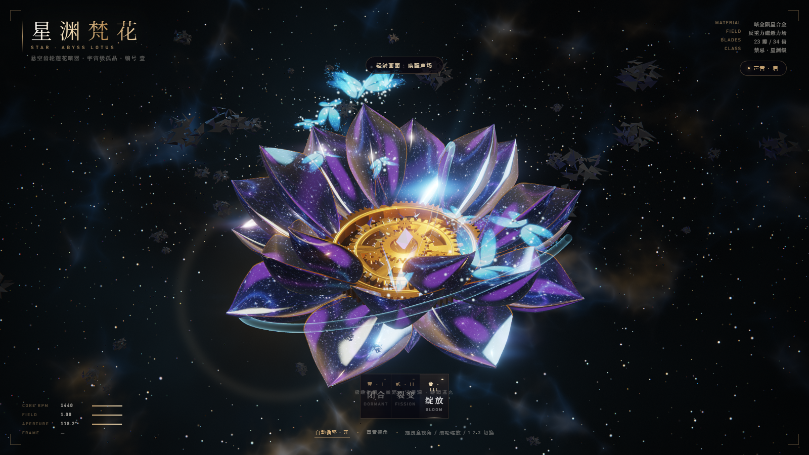
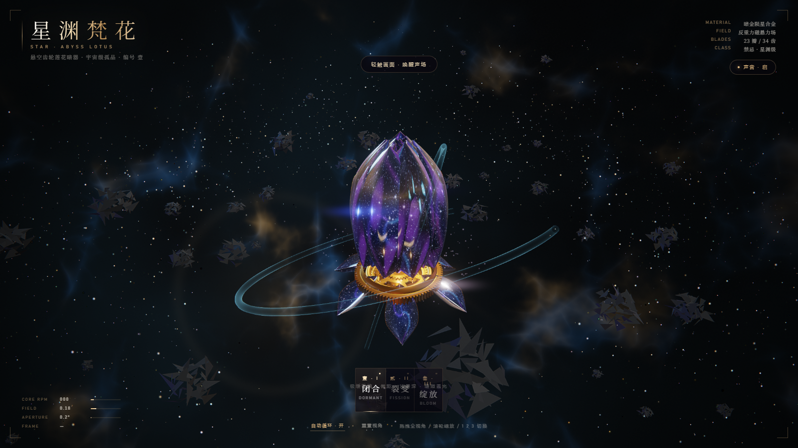
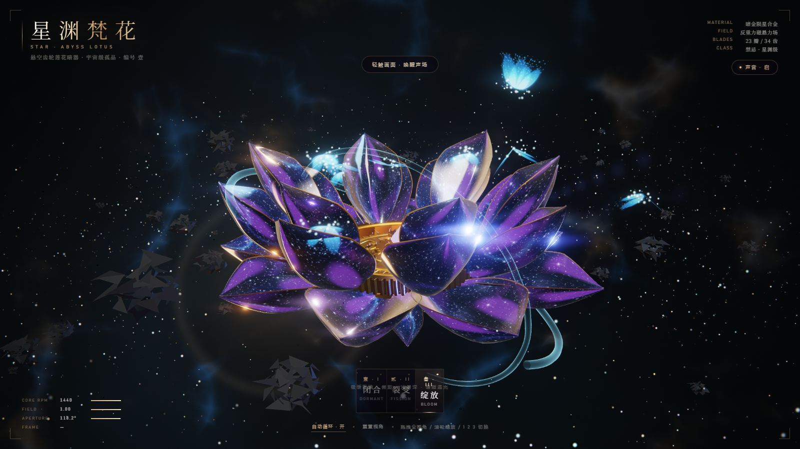
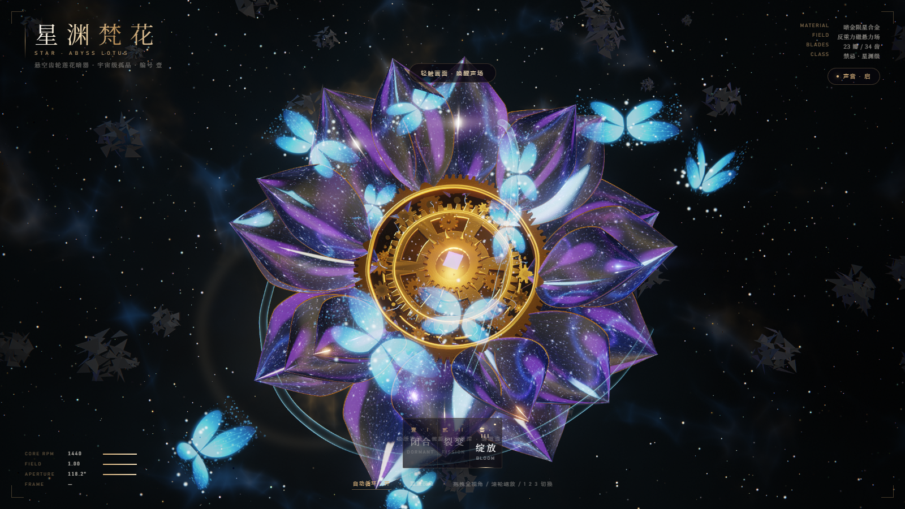

# 星渊梵花 · STAR ABYSS LOTUS

一件**单文件**的 3D 交互展品：悬浮的金属莲花，齿轮为心，星云为瓣。

打开即运行 —— 不需要构建、不联网、无外部资源。全部几何、材质、纹理、
音频都由程序实时生成。

## 运行

下载 `星渊梵花.html`，用新版 Chrome / Edge / Firefox 双击打开即可（`file://` 也能跑）。

- 首次**点击画面**才会启用音频（浏览器自动播放策略限制）
- 设备较弱时在地址后加 `?low=1`（降低分辨率与抗锯齿）
- 若看到旧版本，`Ctrl+F5` 强刷

## 操作

| 操作 | 效果 |
|---|---|
| 拖拽 | 全方向环绕（含仰视） |
| 滚轮 / 双指 | 缩放 |
| `1` `2` `3` | 闭合 / 裂变 / 绽放 |
| `空格` | 自动循环 |
| `R` | 重置视角 |
| `M` | 静音 |

URL 参数：`?state=0|1|2`、`?low=1`、`?noauto=1`、`?cam=θ,φ,r`、`?freeze=1&t=10`

## 三幕

| 闭合 | 裂变 | 绽放 |
|---|---|---|
|  | |  |

- **闭合**：花苞合拢，23 枚花瓣合成一颗星云花苞，机芯收进花托
- **裂变**：花瓣由内而外掀开，蓝色光蝶自花心涌出
- **绽放**：完全展开，中央六窗主齿盘带动整圈齿轮高速运转

## 结构

- **花瓣**：三层 23 枚厚壳勺形瓣（9 / 8 / 6），黑曜石壳体 + 金边。
  瓣面是程序生成的深空 —— 深蓝底、星云漩涡、紫色流光（随时间流动）、白色星芒。
  每片花瓣独立生成几何与 UV，所以没有两瓣星图相同。
- **花心**：下沉的齿轮盆地。中央一枚六窗主齿盘（44 齿、六扇镂空、反向冠环、
  十二枚内向尖冠、紫晶核），外围一圈大小悬殊的小齿轮环绕咬合，
  蓝色电弧在主齿轮与卫星轮之间跳动。
- **底部**：青铜花托 + 6 枚固定萼瓣。
- **渲染**：自建 HDR 后处理链 —— 半浮点 RT、6 级 Bloom、横向拉丝、体积光、
  色差、ACES 调色、锐化，1.45 倍超采样。
- **音频**：Web Audio 实时合成，无音频文件。

## 兼容性

WebGL2。桌面 Chrome / Edge / Firefox / Safari 16+。
移动端可运行，建议 `?low=1`。

## 授权

© 2026 恒CHOO. All rights reserved.
详见 [LICENSE](./LICENSE)。未经许可，不得复制、修改、分发或用于衍生用途。
